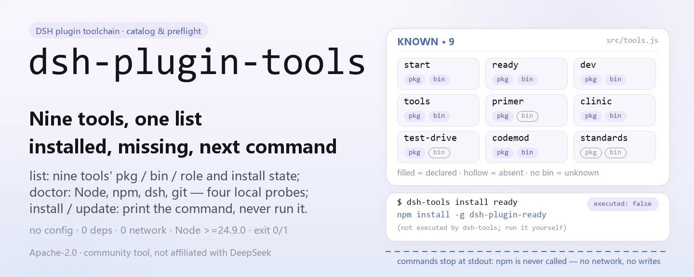
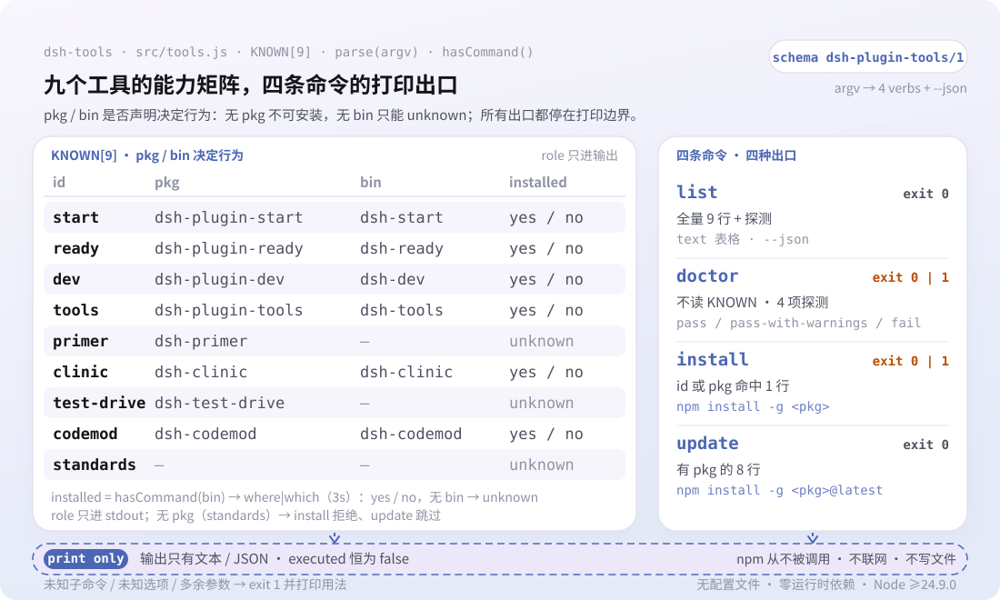

<div align="center">

<picture>
  <source media="(prefers-color-scheme: dark)" srcset="docs/assets/dsh-plugin-tools-hero-en-dark.webp">
  
</picture>

# dsh-plugin-tools

**See the whole DSH plugin toolchain at a glance: what is installed, what your environment is missing, and which command to run next.**

`dsh-tools` is a zero-dependency npx utility: it inspects and prints only — it never installs or updates anything, and every `npm install -g` line is yours to run.

[Install](#three-step-setup) · [Configuration](#configuration) · [FAQ](#faq) · [简体中文](README.md) · [English](README.en.md) · [Español](README.es.md) · [Português](README.pt.md) · [हिन्दी](README.hi.md)

[](LICENSE)
[](https://www.npmjs.com/package/dsh-plugin-tools)
[](https://github.com/PerryLink/dsh-plugin-tools/actions/workflows/test.yml)
[](#three-step-setup)

[](https://github.com/PerryLink/dsh-plugin-tools/stargazers)
[](https://www.npmjs.com/package/dsh-plugin-tools)
[](https://gitee.com/perrylink/dsh-plugin-tools)

```sh
npm i -g dsh-plugin-tools   # global install; the command is dsh-tools
npx dsh-plugin-tools list   # or run it once without installing
```

</div>

<sub>Community tool, not affiliated with DeepSeek. Canonical repository: <https://github.com/PerryLink/dsh-plugin-tools> (Gitee is a mirror).</sub>

## What it is

`dsh-plugin-tools` is the catalog, preflight checker, and install cheat sheet for the DSH plugin developer toolchain. `dsh-tools list` shows the package name, executable name, and role of each of the nine known tools, plus whether it is already installed on this machine; `dsh-tools doctor` checks the four prerequisites Node, npm, dsh, and git; `dsh-tools install <tool>` and `dsh-tools update` print the exact `npm install -g` command to run. It never contacts the npm registry, never writes a file, and does not audit packages, touch the host, or produce scores or rankings.

<picture>
  <source media="(prefers-color-scheme: dark)" srcset="docs/assets/dsh-plugin-tools-flow-v5-dark.svg">
  
</picture>

## Three-step setup

1. **Install** (requires Node ≥24.9.0, per `engines.node` in `package.json`):

   ```sh
   # global install (recommended for regular use)
   npm i -g dsh-plugin-tools
   # or run it once without installing
   npx dsh-plugin-tools list
   ```

   The installed command is `dsh-tools`; `npx dsh-plugin-tools` resolves to the same bin.

2. **Quick usage**:

   ```sh
   dsh-tools list                        # full catalog + local install status
   dsh-tools doctor                      # Node / npm / dsh / git preflight
   dsh-tools install dsh-plugin-ready    # print the install command for ready
   dsh-tools update                      # print @latest commands for the family
   ```

3. **Verify it works**:

   ```sh
   dsh-tools --version
   dsh-tools list --json
   ```

   `list --json` emits `schema: dsh-plugin-tools/1`; `doctor` exits `0` (`pass` or `pass-with-warnings`) or `1` (`fail`).

**Uninstall**: `npm uninstall -g dsh-plugin-tools`.

## Core capabilities

- **`list`: see what exists and what is installed.** Prints the id, npm package name, bin name, and one-line role of each of the nine known tools; `installed` is `yes` / `no` / `unknown`. `primer` and `test-drive` declare no bin, so they are always `unknown`.
- **`doctor`: pre-install environment check.** Checks Node (code threshold ≥20), npm (missing means `fail`), dsh and git (missing means `warn` only); the overall status is `pass`, `pass-with-warnings`, or `fail`, with exit code `1` only on `fail`.
- **`install <tool>`: get the command, change nothing.** Accepts a tool id (`ready`) or package name (`dsh-plugin-ready`); text output always includes `(not executed by dsh-tools; run it yourself)`, and JSON always reports `"executed": false`.
- **`update`: generate update instructions in bulk.** Prints `npm install -g <pkg>@latest` for every tool that has a package, skipping entries such as `standards` that have none.
- **`--json`: built for scripts and CI.** Every command supports it and emits the fixed `schema: dsh-plugin-tools/1`; `doctor --json` also carries a `notClaimed` array spelling out "not a package audit, not a host install, not a security audit."
- **Zero dependencies, zero network.** At runtime it imports only `node:child_process` and `node:fs`, resolving executables with `where` (Windows) or `which` (Unix); it never contacts the npm registry and never writes a file.

### Known tools

| id | npm package | executable | role |
|---|---|---|---|
| `start` | `dsh-plugin-start` | `dsh-start` | scaffold a new plugin |
| `ready` | `dsh-plugin-ready` | `dsh-ready` | static preflight |
| `dev` | `dsh-plugin-dev` | `dsh-dev` | unified dispatcher |
| `tools` | `dsh-plugin-tools` | `dsh-tools` | toolchain manager (this tool) |
| `primer` | `dsh-primer` | — | learn / plan / scaffold knowledge |
| `clinic` | `dsh-clinic` | `dsh-clinic` | static + host-contract checks |
| `test-drive` | `dsh-test-drive` | — | isolated install and smoke test (C3) |
| `codemod` | `dsh-codemod` | `dsh-codemod` | version migration |
| `standards` | — | — | ENTRY / FLOW / BOOST spec and entry-validate |

## Configuration

`dsh-tools` has no config file, no environment variables, and no profile patch — every behavior comes from CLI arguments; with no subcommand it defaults to `list`.

| option | applies to | effect |
|---|---|---|
| `--json` | all commands | emit machine-readable JSON (`schema: dsh-plugin-tools/1`) |
| `-h`, `--help` | all commands | print usage and exit `0` |
| `-v`, `--version` | all commands | print the version and exit `0` |

<details>
<summary>Full command and exit-code reference</summary>

| command | behavior | exit code |
|---|---|---|
| `dsh-tools list [--json]` | print the tool catalog and local install status | `0` |
| `dsh-tools doctor [--json]` | print Node / npm / dsh / git preflight results | `0` (pass or pass-with-warnings); `1` (fail) |
| `dsh-tools install <tool> [--json]` | print the `npm install -g` command for that tool; never execute it | `0`; `1` for an unknown or non-installable tool |
| `dsh-tools update [--json]` | print an `@latest` update command for each installable tool; never execute it | `0` |
| `dsh-tools --help` / `--version` | print usage or the version | `0` |
| unknown command, unknown option, extra argument | print an error plus usage | `1` |

</details>

<details>
<summary>JSON output examples</summary>

`dsh-tools install dsh-plugin-ready --json`:

```json
{
  "schema": "dsh-plugin-tools/1",
  "tool": "ready",
  "package": "dsh-plugin-ready",
  "command": "npm install -g dsh-plugin-ready",
  "executed": false
}
```

`dsh-tools doctor --json`:

```json
{
  "schema": "dsh-plugin-tools/1",
  "tool": "dsh-plugin-tools",
  "version": "0.2.3",
  "generatedAt": "2026-11-06T05:00:00.000Z",
  "status": "pass-with-warnings",
  "checks": [
    { "id": "node", "status": "pass", "detail": "Node 24.9.0; >=20 required" },
    { "id": "npm", "status": "pass", "detail": "npm is required for publishing" },
    { "id": "dsh", "status": "warn", "detail": "dsh CLI is needed for profile/host tests" },
    { "id": "git", "status": "pass", "detail": "git is needed for commits/releases" }
  ],
  "notClaimed": ["not a package audit", "not a host install", "not a security audit"]
}
```

`generatedAt` and each `detail` vary by machine; the block above only shows the field shape.

</details>

## FAQ

<details>
<summary>Will it install or upgrade anything for me?</summary>

No. `install` and `update` only print commands, and JSON always reports `"executed": false`; `test/tools.test.js` asserts that install prints a command and does not execute it. Copy the command and run it yourself — what gets installed and where stays your decision.

</details>

<details>
<summary>Do I need `dsh-plugin-kit` first?</summary>

No. The known-tool list does not contain `dsh-plugin-kit`, and the tests explicitly assert it never appears; the tool itself has zero runtime dependencies.

</details>

<details>
<summary>Does it go online or upload any data?</summary>

No. It never contacts the npm registry, never reads a profile, and never writes a file; `list` only checks PATH via `where` (Windows) or `which` (Unix), and `doctor` only runs four local probes: Node, npm, dsh, and git.

</details>

<details>
<summary>Why is `installed` unknown for some tools?</summary>

`dsh-primer` and `dsh-test-drive` declare no bin field, so there is no executable name to probe and the value stays `unknown`. Every other tool is looked up by bin name on PATH, which means a global install outside PATH is reported as `no`.

</details>

<details>
<summary>Why does `doctor` report Node as PASS when installation requires ≥24.9?</summary>

`doctor` only decides whether its own probing logic can run (threshold ≥20), while `engines.node: >=24.9.0` in `package.json` is the requirement for installing this tool; the two serve different purposes. See Known limitations.

</details>

## Known limitations

- **Prints only, never executes.** `install` and `update` never call npm and never modify your global packages; this is a design boundary, not a pending feature.
- **The tool list is hard-coded.** The nine tools live in the `KNOWN` constant in `src/tools.js`; adding or retiring a tool requires a new release before it shows up.
- **Install status depends on PATH.** Detection runs `where` / `which` against the bin name, so a global package outside PATH — or a same-named binary on PATH — makes `yes` / `no` inaccurate; entries without a bin can only be `unknown`.
- **The Node thresholds disagree.** `doctor` passes at ≥20, while `engines.node` in `package.json` requires ≥24.9.0; the former only says `dsh-tools` can run, the latter is the install requirement.
- **Explicit non-goals.** No package audit, no host install, no security audit, no score or ranking; the `notClaimed` field of `doctor --json` states each of these disclaimers.
- **`standards` is not installable.** It has no npm package, so `dsh-tools install standards` fails with exit `1`.
- **Argument parsing is strict.** An unknown option, unknown subcommand, or extra argument errors out and prints usage instead of partially executing.

## Development

```sh
npm install --ignore-scripts --no-audit --no-fund   # no runtime dependencies
npm test                                            # node --test test/*.test.js
node bin/dsh-tools.js list --json                   # run it straight from the repo
```

No build step: pure ESM, with `bin/dsh-tools.js` and `src/tools.js` as the entire runtime. CI is `.github/workflows/test.yml` (Node 20 / 24 matrix); publishing goes through `.github/workflows/release.yml` (manual trigger, `npm publish --provenance`).

| path | purpose |
|---|---|
| `bin/dsh-tools.js` | npm bin entry that forwards arguments to `src/tools.js` |
| `src/tools.js` | `KNOWN` catalog, argument parsing, and list / doctor / install / update |
| `test/tools.test.js` | 3 `node:test` cases (list / install / doctor) |
| `scripts/gen-readme-assets.py` | generates the four hero webp files and the light/dark flow-v5 SVGs (Python + Pillow) |
| `docs/assets/` | the generated `dsh-plugin-tools-hero-{zh,en}-{light,dark}.webp` and `dsh-plugin-tools-flow-v5-{light,dark}.svg` |
| `.github/workflows/test.yml` | CI: runs `npm test` on Node 20 and 24 |

The artwork is generated programmatically by [`scripts/gen-readme-assets.py`](scripts/gen-readme-assets.py) and can be regenerated at any time: `python scripts/gen-readme-assets.py`. The script probes for msyh.ttc / msyhbd.ttc / consola.ttf at startup and exits with an error when one is missing; the hero comes in zh and en versions, while the structure SVG carries command tokens plus short Chinese notes and is shared by all five README languages.

## Family & thanks

This project is a member of the DeepSeek Harness plugin and tool family maintained by [PerryLink](https://github.com/PerryLink) (all Apache-2.0). Its siblings `dsh-plugin-start`, `dsh-plugin-ready`, `dsh-plugin-dev`, `dsh-clinic`, `dsh-primer`, `dsh-test-drive`, `dsh-codemod`, and `dsh-standards` all appear in this tool's catalog; for the installable ones, `dsh-tools install <tool>` hands you the command.

If it saved you a documentation lookup, **give it a star** — it unlocks nothing, but it helps the next person find it.

## License

[LICENSE](LICENSE) (Apache License 2.0) © 2026 dsh-plugin-tools contributors

<p align="center"><sub>Apache-2.0 · Community tool, not affiliated with DeepSeek.</sub></p>
