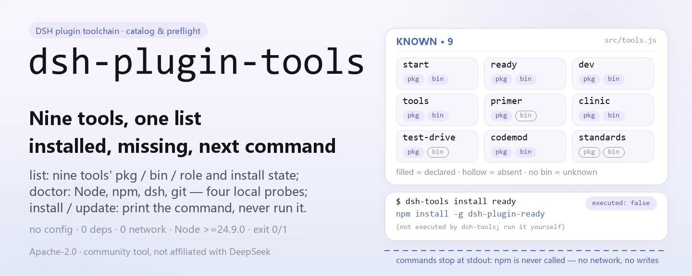
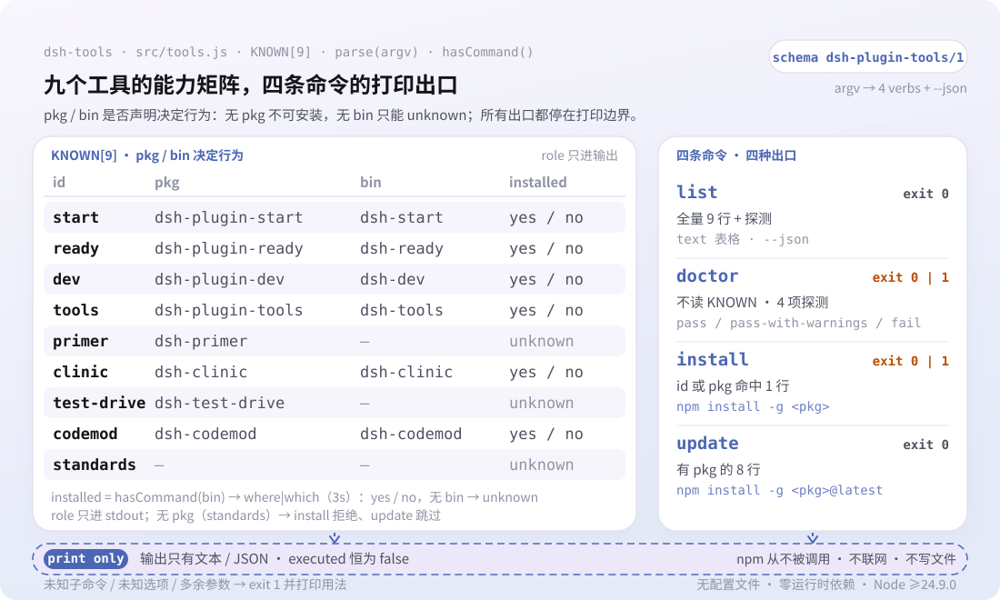

<div align="center">

<picture>
  <source media="(prefers-color-scheme: dark)" srcset="docs/assets/dsh-plugin-tools-hero-en-dark.webp">
  
</picture>

# dsh-plugin-tools

**Toda la cadena de herramientas para plugins de DSH de un vistazo: qué está instalado, qué le falta a tu entorno y qué comando ejecutar después.**

`dsh-tools` es una utilidad npx sin dependencias: solo inspecciona e imprime; nunca instala ni actualiza nada, y cada línea `npm install -g` la ejecutas tú.

[Instalar](#instalación-en-tres-pasos) · [Configuración](#configuración) · [FAQ](#faq) · [简体中文](README.md) · [English](README.en.md) · [Español](README.es.md) · [Português](README.pt.md) · [हिन्दी](README.hi.md)

[](LICENSE)
[](https://www.npmjs.com/package/dsh-plugin-tools)
[](https://github.com/PerryLink/dsh-plugin-tools/actions/workflows/test.yml)
[](#instalación-en-tres-pasos)

[](https://github.com/PerryLink/dsh-plugin-tools/stargazers)
[](https://www.npmjs.com/package/dsh-plugin-tools)
[](https://gitee.com/perrylink/dsh-plugin-tools)

```sh
npm i -g dsh-plugin-tools   # instalación global; el comando es dsh-tools
npx dsh-plugin-tools list   # o ejecútalo una vez sin instalar
```

</div>

<sub>Herramienta de la comunidad, no afiliada a DeepSeek. Repositorio canónico: <https://github.com/PerryLink/dsh-plugin-tools> (Gitee es un espejo).</sub>

## Qué es

`dsh-plugin-tools` es el catálogo, el comprobador previo y la guía de instalación de la cadena de herramientas para plugins de DSH. `dsh-tools list` muestra el nombre del paquete, el nombre del ejecutable y la función de cada una de las nueve herramientas conocidas, además de si ya está instalada en esta máquina; `dsh-tools doctor` comprueba los cuatro requisitos previos Node, npm, dsh y git; `dsh-tools install <tool>` y `dsh-tools update` imprimen el comando exacto `npm install -g` que hay que ejecutar. Nunca contacta con el registro de npm, nunca escribe un archivo y no audita paquetes, no toca el host ni produce puntuaciones o rankings.

<picture>
  <source media="(prefers-color-scheme: dark)" srcset="docs/assets/dsh-plugin-tools-flow-v5-dark.svg">
  
</picture>

## Instalación en tres pasos

1. **Instalar** (requiere Node ≥24.9.0, según `engines.node` de `package.json`):

   ```sh
   # instalación global (recomendada para uso habitual)
   npm i -g dsh-plugin-tools
   # o ejecutarlo una vez sin instalar
   npx dsh-plugin-tools list
   ```

   El comando instalado es `dsh-tools`; `npx dsh-plugin-tools` resuelve al mismo bin.

2. **Uso rápido**:

   ```sh
   dsh-tools list                        # catálogo completo + estado local
   dsh-tools doctor                      # comprobación de Node / npm / dsh / git
   dsh-tools install dsh-plugin-ready    # imprime el comando de ready
   dsh-tools update                      # imprime los comandos @latest de la familia
   ```

3. **Verificar que funciona**:

   ```sh
   dsh-tools --version
   dsh-tools list --json
   ```

   `list --json` emite `schema: dsh-plugin-tools/1`; `doctor` sale con `0` (`pass` o `pass-with-warnings`) o `1` (`fail`).

**Desinstalar**: `npm uninstall -g dsh-plugin-tools`.

## Capacidades clave

- **`list`: ver qué existe y qué está instalado.** Imprime el id, el paquete npm, el nombre del bin y la función de cada una de las nueve herramientas conocidas; `installed` toma `yes` / `no` / `unknown`. `primer` y `test-drive` no declaran bin, así que siempre son `unknown`.
- **`doctor`: comprobación del entorno antes de instalar.** Revisa Node (umbral del código ≥20), npm (si falta, `fail`), dsh y git (si faltan, solo `warn`); el estado global es `pass`, `pass-with-warnings` o `fail`, con código de salida `1` solo en `fail`.
- **`install <tool>`: recibes el comando, no se toca nada.** Acepta un id de herramienta (`ready`) o un nombre de paquete (`dsh-plugin-ready`); la salida de texto siempre incluye `(not executed by dsh-tools; run it yourself)` y el JSON siempre informa `"executed": false`.
- **`update`: genera instrucciones de actualización en lote.** Imprime `npm install -g <pkg>@latest` para cada herramienta con paquete y omite entradas como `standards`, que no lo tienen.
- **`--json`: pensado para scripts y CI.** Todos los comandos lo admiten y emiten el `schema: dsh-plugin-tools/1` fijo; `doctor --json` incluye además un array `notClaimed` que enumera «no es una auditoría de paquetes, no es una instalación en el host, no es una auditoría de seguridad».
- **Cero dependencias, cero red.** En tiempo de ejecución solo importa `node:child_process` y `node:fs`, resuelve ejecutables con `where` (Windows) o `which` (Unix); nunca contacta con el registro de npm ni escribe archivos.

### Herramientas conocidas

| id | paquete npm | ejecutable | función |
|---|---|---|---|
| `start` | `dsh-plugin-start` | `dsh-start` | crear un plugin nuevo (andamiaje) |
| `ready` | `dsh-plugin-ready` | `dsh-ready` | comprobación estática previa |
| `dev` | `dsh-plugin-dev` | `dsh-dev` | despachador unificado |
| `tools` | `dsh-plugin-tools` | `dsh-tools` | gestor de la cadena (esta herramienta) |
| `primer` | `dsh-primer` | — | conocimiento de aprendizaje, planificación y andamiaje |
| `clinic` | `dsh-clinic` | `dsh-clinic` | comprobaciones estáticas + de contrato del host |
| `test-drive` | `dsh-test-drive` | — | instalación aislada y prueba de humo (C3) |
| `codemod` | `dsh-codemod` | `dsh-codemod` | migración de versiones |
| `standards` | — | — | especificación ENTRY / FLOW / BOOST y entry-validate |

## Configuración

`dsh-tools` no tiene archivo de configuración, ni variables de entorno, ni profile patch: todo el comportamiento viene de los argumentos de línea de comandos; sin subcomando, se ejecuta `list` por defecto.

| opción | se aplica a | efecto |
|---|---|---|
| `--json` | todos los comandos | emite JSON legible por máquina (`schema: dsh-plugin-tools/1`) |
| `-h`, `--help` | todos los comandos | imprime el uso y sale con `0` |
| `-v`, `--version` | todos los comandos | imprime la versión y sale con `0` |

<details>
<summary>Referencia completa de comandos y códigos de salida</summary>

| comando | comportamiento | código de salida |
|---|---|---|
| `dsh-tools list [--json]` | imprime el catálogo y el estado de instalación local | `0` |
| `dsh-tools doctor [--json]` | imprime el resultado de Node / npm / dsh / git | `0` (pass o pass-with-warnings); `1` (fail) |
| `dsh-tools install <tool> [--json]` | imprime el comando `npm install -g` de esa herramienta; nunca lo ejecuta | `0`; `1` si la herramienta es desconocida o no instalable |
| `dsh-tools update [--json]` | imprime un comando `@latest` por cada herramienta instalable; nunca lo ejecuta | `0` |
| `dsh-tools --help` / `--version` | imprime el uso o la versión | `0` |
| comando desconocido, opción desconocida, argumento extra | imprime el error y el uso | `1` |

</details>

<details>
<summary>Ejemplos de salida JSON</summary>

`dsh-tools install dsh-plugin-ready --json`:

```json
{
  "schema": "dsh-plugin-tools/1",
  "tool": "ready",
  "package": "dsh-plugin-ready",
  "command": "npm install -g dsh-plugin-ready",
  "executed": false
}
```

`dsh-tools doctor --json`:

```json
{
  "schema": "dsh-plugin-tools/1",
  "tool": "dsh-plugin-tools",
  "version": "0.2.3",
  "generatedAt": "2026-11-06T05:00:00.000Z",
  "status": "pass-with-warnings",
  "checks": [
    { "id": "node", "status": "pass", "detail": "Node 24.9.0; >=20 required" },
    { "id": "npm", "status": "pass", "detail": "npm is required for publishing" },
    { "id": "dsh", "status": "warn", "detail": "dsh CLI is needed for profile/host tests" },
    { "id": "git", "status": "pass", "detail": "git is needed for commits/releases" }
  ],
  "notClaimed": ["not a package audit", "not a host install", "not a security audit"]
}
```

`generatedAt` y cada `detail` varían según la máquina; el bloque anterior solo muestra la forma de los campos.

</details>

## FAQ

<details>
<summary>¿Va a instalar o actualizar algo por mí?</summary>

No. `install` y `update` solo imprimen comandos, y el JSON siempre informa `"executed": false`; `test/tools.test.js` comprueba que install imprime un comando y no lo ejecuta. Copia el comando y ejecútalo tú: qué se instala y dónde sigue siendo tu decisión.

</details>

<details>
<summary>¿Necesito `dsh-plugin-kit` primero?</summary>

No. La lista de herramientas conocidas no contiene `dsh-plugin-kit`, y los tests afirman explícitamente que nunca aparece; la herramienta en sí no tiene dependencias de ejecución.

</details>

<details>
<summary>¿Se conecta a internet o sube datos?</summary>

No. Nunca contacta con el registro de npm, nunca lee un profile y nunca escribe un archivo; `list` solo consulta el PATH con `where` (Windows) o `which` (Unix), y `doctor` solo ejecuta cuatro sondas locales: Node, npm, dsh y git.

</details>

<details>
<summary>¿Por qué `installed` aparece como `unknown` en algunas herramientas?</summary>

`dsh-primer` y `dsh-test-drive` no declaran el campo bin, así que no hay nombre de ejecutable que sondear y el valor queda en `unknown`. Las demás se buscan por nombre de bin en el PATH, por lo que una instalación global fuera del PATH se informa como `no`.

</details>

<details>
<summary>¿Por qué `doctor` dice que Node es PASS si la instalación exige ≥24.9?</summary>

`doctor` solo decide si su propia lógica de sondeo puede ejecutarse (umbral ≥20), mientras que `engines.node: >=24.9.0` en `package.json` es el requisito para instalar esta herramienta; ambos sirven a propósitos distintos. Consulta Limitaciones conocidas.

</details>

## Limitaciones conocidas

- **Solo imprime, nunca ejecuta.** `install` y `update` nunca llaman a npm ni modifican tus paquetes globales; es un límite de diseño, no una función pendiente.
- **La lista de herramientas está codificada.** Las nueve herramientas viven en la constante `KNOWN` de `src/tools.js`; añadir o retirar una exige una nueva versión para que aparezca.
- **El estado de instalación depende del PATH.** La detección ejecuta `where` / `which` sobre el nombre del bin, así que un paquete global fuera del PATH —o un binario con el mismo nombre en el PATH— hace que `yes` / `no` no sea exacto; las entradas sin bin solo pueden ser `unknown`.
- **Los umbrales de Node no coinciden.** `doctor` da PASS a partir de ≥20, mientras que `engines.node` en `package.json` exige ≥24.9.0; lo primero solo dice que `dsh-tools` puede ejecutarse, lo segundo es el requisito de instalación.
- **No objetivos explícitos.** Sin auditoría de paquetes, sin instalación en el host, sin auditoría de seguridad, sin puntuaciones ni rankings; el campo `notClaimed` de `doctor --json` enumera cada una de estas negativas.
- **`standards` no es instalable.** No tiene paquete npm, así que `dsh-tools install standards` falla con código `1`.
- **El análisis de argumentos es estricto.** Una opción desconocida, un subcomando desconocido o un argumento extra provocan un error y el uso, sin ejecución parcial.

## Desarrollo

```sh
npm install --ignore-scripts --no-audit --no-fund   # sin dependencias de ejecución
npm test                                            # node --test test/*.test.js
node bin/dsh-tools.js list --json                   # ejecutarlo desde el repo
```

Sin paso de compilación: ESM puro, con `bin/dsh-tools.js` y `src/tools.js` como todo el runtime. La CI es `.github/workflows/test.yml` (matriz Node 20 / 24); la publicación pasa por `.github/workflows/release.yml` (disparo manual, `npm publish --provenance`).

| ruta | función |
|---|---|
| `bin/dsh-tools.js` | entrada bin de npm que reenvía los argumentos a `src/tools.js` |
| `src/tools.js` | catálogo `KNOWN`, análisis de argumentos y list / doctor / install / update |
| `test/tools.test.js` | 3 casos de `node:test` (list / install / doctor) |
| `scripts/gen-readme-assets.py` | genera los cuatro hero webp y los SVG flow-v5 claro/oscuro (Python + Pillow) |
| `docs/assets/` | los `dsh-plugin-tools-hero-{zh,en}-{light,dark}.webp` y `dsh-plugin-tools-flow-v5-{light,dark}.svg` generados |
| `.github/workflows/test.yml` | CI: ejecuta `npm test` en Node 20 y 24 |

Las imágenes se generan de forma programática con [`scripts/gen-readme-assets.py`](scripts/gen-readme-assets.py) y pueden regenerarse cuando haga falta: `python scripts/gen-readme-assets.py`. El script detecta msyh.ttc / msyhbd.ttc / consola.ttf al arrancar y termina con error si falta alguno; el hero existe en versiones zh y en, mientras que el SVG de estructura contiene solo tokens de comandos y notas breves en chino, y lo comparten los cinco idiomas del README.

## Familia y agradecimientos

Este proyecto es miembro de la familia de plugins y herramientas de DeepSeek Harness mantenida por [PerryLink](https://github.com/PerryLink) (todo Apache-2.0). Sus hermanos `dsh-plugin-start`, `dsh-plugin-ready`, `dsh-plugin-dev`, `dsh-clinic`, `dsh-primer`, `dsh-test-drive`, `dsh-codemod` y `dsh-standards` aparecen en el catálogo de esta herramienta; para los instalables, `dsh-tools install <tool>` te entrega el comando.

Si te ahorró una consulta a la documentación, **dale una estrella**: no desbloquea nada, pero ayuda a que la siguiente persona lo encuentre.

## Licencia

[LICENSE](LICENSE) (Apache License 2.0) © 2026 dsh-plugin-tools contributors

<p align="center"><sub>Apache-2.0 · Herramienta de la comunidad, no afiliada a DeepSeek.</sub></p>
