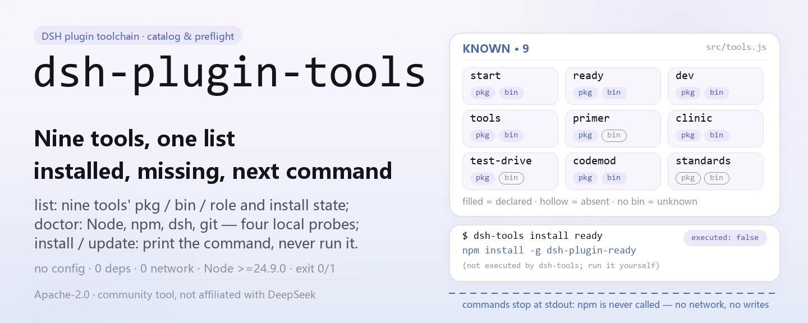
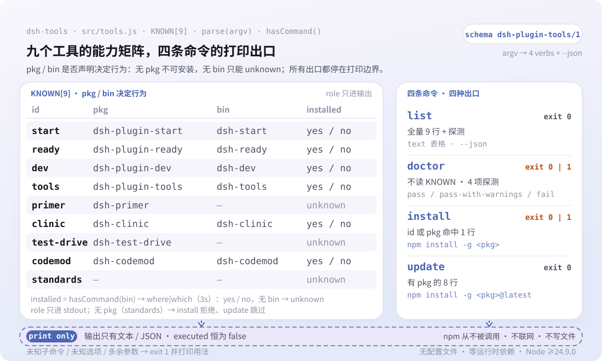

<div align="center">

<picture>
  <source media="(prefers-color-scheme: dark)" srcset="docs/assets/dsh-plugin-tools-hero-en-dark.webp">
  
</picture>

# dsh-plugin-tools

**पूरी DSH प्लगइन टूलचेन एक नज़र में: क्या इंस्टॉल है, आपके एनवायरनमेंट में क्या कमी है, और आगे कौन-सा कमांड चलाना है।**

`dsh-tools` एक ज़ीरो-डिपेंडेंसी npx यूटिलिटी है: यह सिर्फ़ जाँचती और छापती है — कभी खुद इंस्टॉल या अपडेट नहीं करती, और हर `npm install -g` पंक्ति आप खुद चलाते हैं।

[इंस्टॉल](#तीन-चरणों-में-शुरुआत) · [कॉन्फ़िगरेशन](#कॉन्फ़िगरेशन) · [FAQ](#faq) · [简体中文](README.md) · [English](README.en.md) · [Español](README.es.md) · [Português](README.pt.md) · [हिन्दी](README.hi.md)

[](LICENSE)
[](https://www.npmjs.com/package/dsh-plugin-tools)
[](https://github.com/PerryLink/dsh-plugin-tools/actions/workflows/test.yml)
[](#तीन-चरणों-में-शुरुआत)

[](https://github.com/PerryLink/dsh-plugin-tools/stargazers)
[](https://www.npmjs.com/package/dsh-plugin-tools)
[](https://gitee.com/perrylink/dsh-plugin-tools)

```sh
npm i -g dsh-plugin-tools   # ग्लोबल इंस्टॉल; कमांड का नाम dsh-tools है
npx dsh-plugin-tools list   # या बिना इंस्टॉल किए एक बार चलाएँ
```

</div>

<sub>समुदाय द्वारा बनाया गया टूल, DeepSeek से संबद्ध नहीं। आधिकारिक रेपो: <https://github.com/PerryLink/dsh-plugin-tools> (Gitee एक मिरर है)।</sub>

## यह क्या है

`dsh-plugin-tools` DSH प्लगइन डेवलपर टूलचेन का कैटलॉग, प्रीफ़्लाइट चेकर और इंस्टॉल गाइड है। `dsh-tools list` नौ ज्ञात टूल्स में से हर एक का पैकेज नाम, एक्ज़ीक्यूटेबल नाम और भूमिका दिखाता है, और यह भी कि वह इस मशीन पर पहले से इंस्टॉल है या नहीं; `dsh-tools doctor` चार पूर्वापेक्षाएँ जाँचता है — Node, npm, dsh और git; `dsh-tools install <tool>` और `dsh-tools update` चलाने वाला सटीक `npm install -g` कमांड छापते हैं। यह npm रजिस्ट्री से कभी संपर्क नहीं करता, कोई फ़ाइल नहीं लिखता, और न पैकेज ऑडिट करता है, न होस्ट को छूता है, न स्कोर या रैंकिंग बनाता है।

<picture>
  <source media="(prefers-color-scheme: dark)" srcset="docs/assets/dsh-plugin-tools-flow-v5-dark.svg">
  
</picture>

## तीन चरणों में शुरुआत

1. **इंस्टॉल करें** (Node ≥24.9.0 आवश्यक, `package.json` के `engines.node` के अनुसार):

   ```sh
   # ग्लोबल इंस्टॉल (नियमित उपयोग के लिए अनुशंसित)
   npm i -g dsh-plugin-tools
   # या बिना इंस्टॉल किए एक बार चलाएँ
   npx dsh-plugin-tools list
   ```

   इंस्टॉल के बाद कमांड का नाम `dsh-tools` है; `npx dsh-plugin-tools` उसी bin पर रिज़ॉल्व होता है।

2. **तेज़ उपयोग**:

   ```sh
   dsh-tools list                        # पूरा कैटलॉग + स्थानीय इंस्टॉल स्थिति
   dsh-tools doctor                      # Node / npm / dsh / git प्रीफ़्लाइट
   dsh-tools install dsh-plugin-ready    # ready का इंस्टॉल कमांड छापें
   dsh-tools update                      # पूरे परिवार के @latest कमांड छापें
   ```

3. **जाँचें कि काम कर रहा है**:

   ```sh
   dsh-tools --version
   dsh-tools list --json
   ```

   `list --json` में `schema: dsh-plugin-tools/1` आता है; `doctor` का एग्ज़िट कोड `0` (`pass` या `pass-with-warnings`) या `1` (`fail`) होता है।

**अनइंस्टॉल**: `npm uninstall -g dsh-plugin-tools`।

## मुख्य क्षमताएँ

- **`list`: देखें क्या है और क्या इंस्टॉल है।** नौ ज्ञात टूल्स में से हर एक का id, npm पैकेज, bin नाम और एक पंक्ति की भूमिका छापता है; `installed` का मान `yes` / `no` / `unknown` होता है। `primer` और `test-drive` कोई bin नहीं घोषित करते, इसलिए वे हमेशा `unknown` रहते हैं।
- **`doctor`: इंस्टॉल से पहले एनवायरनमेंट जाँच।** Node (कोड की सीमा ≥20), npm (न मिले तो `fail`), dsh और git (न मिलें तो केवल `warn`) जाँचता है; कुल स्थिति `pass`, `pass-with-warnings` या `fail` होती है, और एग्ज़िट कोड केवल `fail` पर `1` होता है।
- **`install <tool>`: कमांड मिलेगा, मशीन पर कुछ नहीं बदलेगा।** टूल id (`ready`) या पैकेज नाम (`dsh-plugin-ready`) स्वीकार करता है; टेक्स्ट आउटपुट में हमेशा `(not executed by dsh-tools; run it yourself)` रहता है और JSON में `executed` हमेशा `false` होता है।
- **`update`: बैच में अपडेट निर्देश बनाएँ।** हर ऐसे टूल के लिए `npm install -g <pkg>@latest` छापता है जिसका पैकेज है; `standards` जैसी बिना पैकेज वाली प्रविष्टियाँ छोड़ देता है।
- **`--json`: स्क्रिप्ट और CI के लिए।** सभी कमांड इसे स्वीकार करते हैं और तय `schema: dsh-plugin-tools/1` छापते हैं; `doctor --json` में `notClaimed` ऐरे भी आता है जो स्पष्ट करता है कि यह पैकेज ऑडिट, होस्ट इंस्टॉल या सुरक्षा ऑडिट नहीं है।
- **ज़ीरो डिपेंडेंसी, ज़ीरो नेटवर्क।** रनटाइम पर यह केवल `node:child_process` और `node:fs` इम्पोर्ट करता है, `where` (Windows) या `which` (Unix) से एक्ज़ीक्यूटेबल ढूँढता है; npm रजिस्ट्री से कभी संपर्क नहीं करता और कोई फ़ाइल नहीं लिखता।

### ज्ञात टूल्स

| id | npm पैकेज | एक्ज़ीक्यूटेबल | भूमिका |
|---|---|---|---|
| `start` | `dsh-plugin-start` | `dsh-start` | नया प्लगइन बनाना (स्कैफ़ोल्ड) |
| `ready` | `dsh-plugin-ready` | `dsh-ready` | स्टैटिक प्रीफ़्लाइट |
| `dev` | `dsh-plugin-dev` | `dsh-dev` | एकीकृत डिस्पैचर |
| `tools` | `dsh-plugin-tools` | `dsh-tools` | टूलचेन प्रबंधक (यह टूल) |
| `primer` | `dsh-primer` | — | सीखना, योजना और स्कैफ़ोल्ड ज्ञान |
| `clinic` | `dsh-clinic` | `dsh-clinic` | स्टैटिक + होस्ट-कॉन्ट्रैक्ट जाँच |
| `test-drive` | `dsh-test-drive` | — | पृथक इंस्टॉल और स्मोक टेस्ट (C3) |
| `codemod` | `dsh-codemod` | `dsh-codemod` | वर्ज़न माइग्रेशन |
| `standards` | — | — | ENTRY / FLOW / BOOST स्पेक और entry-validate |

## कॉन्फ़िगरेशन

`dsh-tools` में कोई कॉन्फ़िग फ़ाइल, एनवायरनमेंट वेरिएबल या profile patch नहीं है — सारा व्यवहार कमांड-लाइन आर्ग्युमेंट से तय होता है; कोई सबकमांड न देने पर डिफ़ॉल्ट रूप से `list` चलता है।

| विकल्प | किन कमांड पर लागू | प्रभाव |
|---|---|---|
| `--json` | सभी कमांड | मशीन-पठनीय JSON (`schema: dsh-plugin-tools/1`) छापता है |
| `-h`, `--help` | सभी कमांड | उपयोग छापता है और `0` के साथ बाहर निकलता है |
| `-v`, `--version` | सभी कमांड | वर्ज़न छापता है और `0` के साथ बाहर निकलता है |

<details>
<summary>पूरा कमांड और एग्ज़िट-कोड संदर्भ</summary>

| कमांड | व्यवहार | एग्ज़िट कोड |
|---|---|---|
| `dsh-tools list [--json]` | टूल कैटलॉग और स्थानीय इंस्टॉल स्थिति छापता है | `0` |
| `dsh-tools doctor [--json]` | Node / npm / dsh / git की जाँच का परिणाम छापता है | `0` (pass या pass-with-warnings); `1` (fail) |
| `dsh-tools install <tool> [--json]` | उस टूल का `npm install -g` कमांड छापता है, चलाता नहीं | `0`; टूल अज्ञात या इंस्टॉल करने योग्य न हो तो `1` |
| `dsh-tools update [--json]` | हर इंस्टॉल करने योग्य टूल के लिए `@latest` कमांड छापता है, चलाता नहीं | `0` |
| `dsh-tools --help` / `--version` | उपयोग या वर्ज़न छापता है | `0` |
| अज्ञात कमांड, अज्ञात विकल्प, अतिरिक्त आर्ग्युमेंट | त्रुटि और उपयोग छापता है | `1` |

</details>

<details>
<summary>JSON आउटपुट उदाहरण</summary>

`dsh-tools install dsh-plugin-ready --json`:

```json
{
  "schema": "dsh-plugin-tools/1",
  "tool": "ready",
  "package": "dsh-plugin-ready",
  "command": "npm install -g dsh-plugin-ready",
  "executed": false
}
```

`dsh-tools doctor --json`:

```json
{
  "schema": "dsh-plugin-tools/1",
  "tool": "dsh-plugin-tools",
  "version": "0.2.3",
  "generatedAt": "2026-11-06T05:00:00.000Z",
  "status": "pass-with-warnings",
  "checks": [
    { "id": "node", "status": "pass", "detail": "Node 24.9.0; >=20 required" },
    { "id": "npm", "status": "pass", "detail": "npm is required for publishing" },
    { "id": "dsh", "status": "warn", "detail": "dsh CLI is needed for profile/host tests" },
    { "id": "git", "status": "pass", "detail": "git is needed for commits/releases" }
  ],
  "notClaimed": ["not a package audit", "not a host install", "not a security audit"]
}
```

`generatedAt` और हर `detail` मशीन के अनुसार बदलते हैं; ऊपर का ब्लॉक केवल फ़ील्ड का आकार दिखाता है।

</details>

## FAQ

<details>
<summary>क्या यह मेरे लिए कुछ इंस्टॉल या अपडेट करेगा?</summary>

नहीं। `install` और `update` केवल कमांड छापते हैं, और JSON में हमेशा `"executed": false` रहता है; `test/tools.test.js` भी जाँचता है कि install कमांड छापता है और उसे चलाता नहीं। कमांड कॉपी करके आप खुद चलाएँ — क्या इंस्टॉल होगा और कहाँ, यह आपका फ़ैसला है।

</details>

<details>
<summary>क्या पहले `dsh-plugin-kit` चाहिए?</summary>

नहीं। ज्ञात टूल्स की सूची में `dsh-plugin-kit` नहीं है, और टेस्ट स्पष्ट रूप से जाँचते हैं कि वह कभी नहीं आता; इस टूल की खुद की कोई रनटाइम डिपेंडेंसी नहीं है।

</details>

<details>
<summary>क्या यह इंटरनेट से जुड़ता है या डेटा अपलोड करता है?</summary>

नहीं। यह npm रजिस्ट्री से कभी संपर्क नहीं करता, कोई profile नहीं पढ़ता और कोई फ़ाइल नहीं लिखता; `list` केवल `where` (Windows) या `which` (Unix) से PATH देखता है, और `doctor` केवल चार स्थानीय जाँचें चलाता है: Node, npm, dsh और git।

</details>

<details>
<summary>कुछ टूल्स के लिए `installed` `unknown` क्यों है?</summary>

`dsh-primer` और `dsh-test-drive` कोई bin फ़ील्ड नहीं घोषित करते, इसलिए जाँचने के लिए कोई एक्ज़ीक्यूटेबल नाम नहीं है और मान `unknown` रहता है। बाकी टूल्स bin नाम से PATH पर खोजे जाते हैं, इसलिए PATH के बाहर की ग्लोबल इंस्टॉल `no` बताई जाती है।

</details>

<details>
<summary>जब इंस्टॉल के लिए ≥24.9 चाहिए, तो `doctor` Node को PASS क्यों कहता है?</summary>

`doctor` केवल यह तय करता है कि उसका अपना प्रोबिंग लॉजिक चल सकता है (सीमा ≥20), जबकि `package.json` में `engines.node: >=24.9.0` इस टूल को इंस्टॉल करने की शर्त है; दोनों अलग उद्देश्यों के लिए हैं। देखें ज्ञात सीमाएँ।

</details>

## ज्ञात सीमाएँ

- **केवल छापता है, चलाता नहीं।** `install` और `update` कभी npm नहीं बुलाते और आपके ग्लोबल पैकेज नहीं बदलते; यह डिज़ाइन की सीमा है, कोई बाकी काम नहीं।
- **टूल सूची हार्डकोडेड है।** नौ टूल्स `src/tools.js` के `KNOWN` कॉन्स्टेंट में लिखे हैं; किसी टूल को जोड़ने या हटाने के लिए नया वर्ज़न चाहिए।
- **इंस्टॉल स्थिति PATH पर निर्भर है।** जाँच `where` / `which` से bin नाम पर होती है, इसलिए PATH के बाहर का ग्लोबल पैकेज — या PATH पर उसी नाम का कोई बाइनरी — `yes` / `no` को ग़लत बना देता है; बिना bin वाली प्रविष्टियाँ केवल `unknown` हो सकती हैं।
- **Node की सीमाएँ अलग-अलग हैं।** `doctor` ≥20 पर PASS देता है, जबकि `package.json` में `engines.node` ≥24.9.0 माँगता है; पहला केवल बताता है कि `dsh-tools` चल सकता है, दूसरा इंस्टॉल की शर्त है।
- **स्पष्ट गैर-लक्ष्य।** कोई पैकेज ऑडिट नहीं, कोई होस्ट इंस्टॉल नहीं, कोई सुरक्षा ऑडिट नहीं, कोई स्कोर या रैंकिंग नहीं; `doctor --json` का `notClaimed` फ़ील्ड इनमें से हर इनकार को लिखता है।
- **`standards` इंस्टॉल करने योग्य नहीं है।** इसका कोई npm पैकेज नहीं, इसलिए `dsh-tools install standards` त्रुटि के साथ `1` लौटाता है।
- **आर्ग्युमेंट पार्सिंग सख़्त है।** अज्ञात विकल्प, अज्ञात सबकमांड या अतिरिक्त आर्ग्युमेंट सीधे त्रुटि और उपयोग दिखाते हैं, आधा-अधूरा नहीं चलाते।

## डेवलपमेंट

```sh
npm install --ignore-scripts --no-audit --no-fund   # कोई रनटाइम डिपेंडेंसी नहीं
npm test                                            # node --test test/*.test.js
node bin/dsh-tools.js list --json                   # रेपो से सीधे चलाएँ
```

कोई बिल्ड स्टेप नहीं: शुद्ध ESM, और पूरा रनटाइम `bin/dsh-tools.js` तथा `src/tools.js` है। CI `.github/workflows/test.yml` है (Node 20 / 24 मैट्रिक्स); प्रकाशन `.github/workflows/release.yml` से होता है (मैन्युअल ट्रिगर, `npm publish --provenance`)।

| पथ | उद्देश्य |
|---|---|
| `bin/dsh-tools.js` | npm bin प्रवेश, आर्ग्युमेंट `src/tools.js` को भेजता है |
| `src/tools.js` | `KNOWN` सूची, आर्ग्युमेंट पार्सिंग और list / doctor / install / update |
| `test/tools.test.js` | 3 `node:test` केस (list / install / doctor) |
| `scripts/gen-readme-assets.py` | चार hero webp और हल्के/गहरे flow-v5 SVG बनाता है (Python + Pillow) |
| `docs/assets/` | बने हुए `dsh-plugin-tools-hero-{zh,en}-{light,dark}.webp` और `dsh-plugin-tools-flow-v5-{light,dark}.svg` |
| `.github/workflows/test.yml` | CI: Node 20 और 24 पर `npm test` |

चित्र [`scripts/gen-readme-assets.py`](scripts/gen-readme-assets.py) से प्रोग्रामेटिक रूप से बनते हैं और कभी भी दोबारा बनाए जा सकते हैं: `python scripts/gen-readme-assets.py`। स्क्रिप्ट शुरू में msyh.ttc / msyhbd.ttc / consola.ttf खोजती है और कोई न मिलने पर त्रुटि के साथ बंद हो जाती है; hero zh और en संस्करणों में है, जबकि संरचना वाला SVG केवल कमांड टोकन और छोटी चीनी टिप्पणियाँ रखता है और पाँचों README भाषाएँ उसे साझा करती हैं।

## परिवार और आभार

यह प्रोजेक्ट [PerryLink](https://github.com/PerryLink) द्वारा अनुरक्षित DeepSeek Harness प्लगइन और टूल परिवार का सदस्य है (सभी Apache-2.0)। इसके सहोदर `dsh-plugin-start`, `dsh-plugin-ready`, `dsh-plugin-dev`, `dsh-clinic`, `dsh-primer`, `dsh-test-drive`, `dsh-codemod` और `dsh-standards` इस टूल के कैटलॉग में दिखते हैं; जो इंस्टॉल करने योग्य हैं, उनके लिए `dsh-tools install <tool>` सीधे कमांड दे देता है।

अगर इसने आपकी एक दस्तावेज़-खोज बचाई हो, तो **एक स्टार दें** — इससे कोई सुविधा नहीं खुलती, लेकिन अगले व्यक्ति को इसे ढूँढना आसान होता है।

## लाइसेंस

[LICENSE](LICENSE) (Apache License 2.0) © 2026 dsh-plugin-tools contributors

<p align="center"><sub>Apache-2.0 · समुदाय द्वारा बनाया गया टूल, DeepSeek से संबद्ध नहीं।</sub></p>
