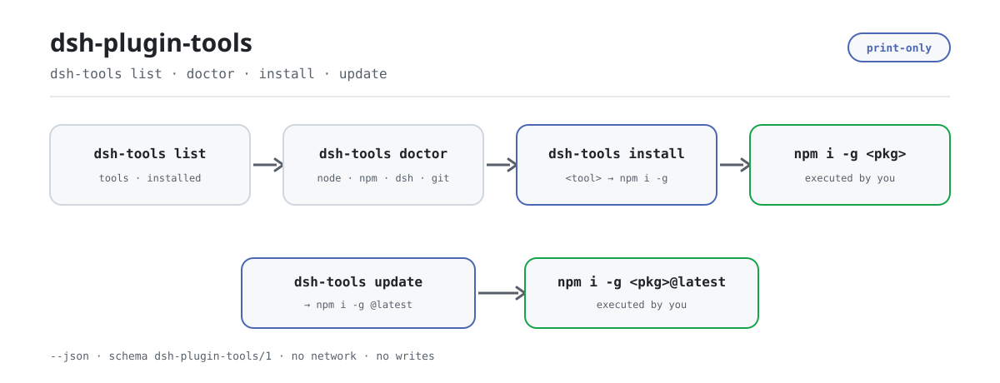

<div align="center">

<picture>
  <source media="(prefers-color-scheme: dark)" srcset="docs/assets/dsh-plugin-tools-flow-dark.svg">
  
</picture>

# dsh-plugin-tools

**一条命令看清 DSH 插件开发工具链：谁已经装了、环境差什么、下一步该敲哪条命令。**

`dsh-tools` 是一个零依赖的 npx 小工具：它只检查、只打印，绝不替你安装或更新——每条 `npm install -g` 都由你亲手执行。

[安装](#三步上手) · [配置](#配置) · [FAQ](#faq) · [简体中文](README.md) · [English](README.en.md) · [Español](README.es.md) · [Português](README.pt.md) · [हिन्दी](README.hi.md)

[](LICENSE)
[](https://www.npmjs.com/package/dsh-plugin-tools)
[](https://github.com/PerryLink/dsh-plugin-tools/actions/workflows/test.yml)
[](#三步上手)

[](https://github.com/PerryLink/dsh-plugin-tools/stargazers)
[](https://www.npmjs.com/package/dsh-plugin-tools)
[](https://gitee.com/perrylink/dsh-plugin-tools)

```sh
npm i -g dsh-plugin-tools   # 全局安装，之后用 dsh-tools
npx dsh-plugin-tools list   # 或者不安装，临时跑一次
```

</div>

<sub>社区工具，与 DeepSeek 官方无关。唯一仓库：<https://github.com/PerryLink/dsh-plugin-tools>（Gitee 为镜像）。</sub>

## 它是什么

`dsh-plugin-tools` 是 DSH 插件开发工具链的目录、体检器和安装说明书。`dsh-tools list` 列出九个已知工具的包名、可执行文件名和职责，并标出本机是否已经装好；`dsh-tools doctor` 检查 Node、npm、dsh、git 四项前提；`dsh-tools install <tool>` 与 `dsh-tools update` 把该执行的 `npm install -g` 命令原样打印出来。它不访问 npm registry、不写任何文件，也不审计包、不碰宿主、不评分排名。

## 三步上手

1. **安装**（前置要求：Node ≥24.9.0，见 `package.json` 的 `engines.node`）：

   ```sh
   # 全局安装（推荐长期使用）
   npm i -g dsh-plugin-tools
   # 不装全局，临时运行
   npx dsh-plugin-tools list
   ```

   安装后的命令名是 `dsh-tools`；`npx dsh-plugin-tools` 会解析到同一个 bin。

2. **快速用法**：

   ```sh
   dsh-tools list                        # 全家桶清单 + 本机安装状态
   dsh-tools doctor                      # Node / npm / dsh / git 四项体检
   dsh-tools install dsh-plugin-ready    # 打印 ready 的安装命令
   dsh-tools update                      # 打印全家族的 @latest 更新命令
   ```

3. **验证已生效**：

   ```sh
   dsh-tools --version
   dsh-tools list --json
   ```

   `list --json` 会输出 `schema: dsh-plugin-tools/1`；`doctor` 的退出码为 `0`（`pass` 或 `pass-with-warnings`）或 `1`（`fail`）。

**卸载**：`npm uninstall -g dsh-plugin-tools`。

## 核心能力

- **`list`：先看有什么、装没装。** 列出九个已知工具的 id、npm 包名、bin 名和一句话职责；`installed` 取值为 `yes` / `no` / `unknown`。`primer` 与 `test-drive` 没有声明 bin，所以恒为 `unknown`。
- **`doctor`：安装前的环境体检。** 检查 Node（代码门槛 ≥20）、npm（缺失直接 `fail`）、dsh 与 git（缺失只 `warn`）；总体状态为 `pass`、`pass-with-warnings` 或 `fail`，只有 `fail` 时退出码为 `1`。
- **`install <tool>`：给你命令，不动你的机器。** 参数可以是工具 id（`ready`）或包名（`dsh-plugin-ready`）；文本输出固定带 `(not executed by dsh-tools; run it yourself)`，JSON 输出里 `executed` 恒为 `false`。
- **`update`：批量生成更新说明。** 对每个有包名的工具打印 `npm install -g <pkg>@latest`，跳过 `standards` 这类没有包名的条目。
- **`--json`：给脚本和 CI 用。** 所有命令都支持，输出带固定 `schema: dsh-plugin-tools/1`；`doctor --json` 还带 `notClaimed` 数组，明确写出「不是包审计、不是宿主安装、不是安全审计」。
- **零依赖、零网络。** 运行时只 import `node:child_process` 与 `node:fs`，用 `where`（Windows）或 `which`（Unix）查可执行文件，不访问 npm registry、不写文件。

### 已知工具

| id | npm 包 | 可执行文件 | 职责 |
|---|---|---|---|
| `start` | `dsh-plugin-start` | `dsh-start` | 脚手架：新建插件 |
| `ready` | `dsh-plugin-ready` | `dsh-ready` | 静态预检 |
| `dev` | `dsh-plugin-dev` | `dsh-dev` | 统一调度器 |
| `tools` | `dsh-plugin-tools` | `dsh-tools` | 工具链管理（本工具） |
| `primer` | `dsh-primer` | — | 学习、规划与脚手架知识 |
| `clinic` | `dsh-clinic` | `dsh-clinic` | 静态检查 + 宿主契约检查 |
| `test-drive` | `dsh-test-drive` | — | 隔离安装与冒烟测试（C3） |
| `codemod` | `dsh-codemod` | `dsh-codemod` | 版本迁移 |
| `standards` | — | — | ENTRY / FLOW / BOOST 规范与 entry-validate |

## 配置

`dsh-tools` 没有配置文件、没有环境变量，也没有 profile patch——全部行为由命令行参数决定；不带子命令时默认执行 `list`。

| 参数 | 适用命令 | 作用 |
|---|---|---|
| `--json` | 全部 | 输出机器可读 JSON（`schema: dsh-plugin-tools/1`） |
| `-h`, `--help` | 全部 | 打印用法并以 `0` 退出 |
| `-v`, `--version` | 全部 | 打印版本号并以 `0` 退出 |

<details>
<summary>完整命令与退出码</summary>

| 命令 | 行为 | 退出码 |
|---|---|---|
| `dsh-tools list [--json]` | 打印工具清单与本机安装状态 | `0` |
| `dsh-tools doctor [--json]` | 打印 Node / npm / dsh / git 体检结果 | `0`（pass 或 pass-with-warnings）；`1`（fail） |
| `dsh-tools install <tool> [--json]` | 打印该工具的 `npm install -g` 命令，不执行 | `0`；工具未知或不可安装时为 `1` |
| `dsh-tools update [--json]` | 打印每个可安装工具的 `@latest` 更新命令，不执行 | `0` |
| `dsh-tools --help` / `--version` | 打印用法或版本号 | `0` |
| 未知子命令、未知参数、多余参数 | 报错并打印用法 | `1` |

</details>

<details>
<summary>JSON 输出示例</summary>

`dsh-tools install dsh-plugin-ready --json`：

```json
{
  "schema": "dsh-plugin-tools/1",
  "tool": "ready",
  "package": "dsh-plugin-ready",
  "command": "npm install -g dsh-plugin-ready",
  "executed": false
}
```

`dsh-tools doctor --json`：

```json
{
  "schema": "dsh-plugin-tools/1",
  "tool": "dsh-plugin-tools",
  "version": "0.2.3",
  "generatedAt": "2026-11-06T05:00:00.000Z",
  "status": "pass-with-warnings",
  "checks": [
    { "id": "node", "status": "pass", "detail": "Node 24.9.0; >=20 required" },
    { "id": "npm", "status": "pass", "detail": "npm is required for publishing" },
    { "id": "dsh", "status": "warn", "detail": "dsh CLI is needed for profile/host tests" },
    { "id": "git", "status": "pass", "detail": "git is needed for commits/releases" }
  ],
  "notClaimed": ["not a package audit", "not a host install", "not a security audit"]
}
```

`generatedAt` 与各项 `detail` 随机器环境变化，上面只是字段形状示例。

</details>

## FAQ

<details>
<summary>它会替我安装或升级吗？</summary>

不会。`install` 与 `update` 只打印命令，JSON 里 `executed: false`；`test/tools.test.js` 也断言了「install 打印命令且不执行」。复制命令自己执行，装什么、装到哪由你决定。

</details>

<details>
<summary>需要先装 `dsh-plugin-kit` 吗？</summary>

不需要。已知清单里没有 `dsh-plugin-kit`，测试也显式断言它不会出现；本工具自身零运行时依赖。

</details>

<details>
<summary>它会联网或上传数据吗？</summary>

不会。它不访问 npm registry、不读 profile、不写文件；`list` 只通过 `where`（Windows）或 `which`（Unix）查 PATH，`doctor` 只跑 Node、npm、dsh、git 四项本地探测。

</details>

<details>
<summary>为什么有些工具的 `installed` 是 `unknown`？</summary>

`dsh-primer` 与 `dsh-test-drive` 没有声明 bin 字段，没有可探测的可执行文件名，因此只能显示 `unknown`。其余工具按 bin 名查 PATH，装在 PATH 之外时会被误判为 `no`。

</details>

<details>
<summary>为什么 `doctor` 说 Node 是 PASS，安装却要求 ≥24.9？</summary>

`doctor` 只判断自己的探测逻辑能否运行（门槛 ≥20），`package.json` 的 `engines.node: >=24.9.0` 才是安装本工具的要求；两者服务不同目的，详见「已知限制」。

</details>

## 已知限制

- **只打印，不执行。** `install` 与 `update` 永远不会调用 npm，也不会改动你的全局包；这是设计边界，不是待办。
- **工具清单是硬编码的。** 九个工具写在 `src/tools.js` 的 `KNOWN` 常量里；新增或下线工具必须发新版本才可见。
- **安装状态依赖 PATH。** 探测方式是 `where` / `which` 查 bin 名：全局包装在 PATH 之外、或 PATH 上有同名二进制时，`yes` / `no` 会失真；没有 bin 的条目只能是 `unknown`。
- **Node 门槛不一致。** `doctor` 按 ≥20 判 PASS，而 `package.json` 的 `engines.node` 要求 ≥24.9.0；前者只说明 `dsh-tools` 能跑，后者才是安装要求。
- **明确的不作为。** 不做包审计、不做宿主安装、不做安全审计、不做评分或排名；`doctor --json` 的 `notClaimed` 字段逐条写明了这些否定声明。
- **`standards` 不可安装。** 它没有对应的 npm 包，`dsh-tools install standards` 会报错并返回 `1`。
- **参数解析是严格的。** 未知选项、未知子命令、多余参数都会直接报错并打印用法，不会「部分执行」。

## 开发

```sh
npm install --ignore-scripts --no-audit --no-fund   # 无运行时依赖
npm test                                            # node --test test/*.test.js
node bin/dsh-tools.js list --json                   # 本地直接运行
```

无构建步骤：纯 ESM，`bin/dsh-tools.js` 与 `src/tools.js` 即全部运行时代码。CI 为 `.github/workflows/test.yml`（Node 20 / 24 矩阵）；发布走 `.github/workflows/release.yml`（手动触发，`npm publish --provenance`）。

| 路径 | 作用 |
|---|---|
| `bin/dsh-tools.js` | npm bin 入口，只把参数转发给 `src/tools.js` |
| `src/tools.js` | `KNOWN` 清单、参数解析与 list / doctor / install / update 实现 |
| `test/tools.test.js` | 3 个 `node:test` 用例（list / install / doctor） |
| `scripts/gen-readme-assets.py` | 生成深浅双版 hero SVG（Python + Pillow） |
| `docs/assets/` | 生成的 `dsh-plugin-tools-flow-{light,dark}.svg` |
| `.github/workflows/test.yml` | CI：Node 20 与 24 上跑 `npm test` |

配图由 [`scripts/gen-readme-assets.py`](scripts/gen-readme-assets.py) 程序化生成，可重复执行：`python scripts/gen-readme-assets.py`。脚本启动时探测 CJK 字体，找不到会直接报错退出；输出的两个 SVG 只含命令 token，五语共用同一对文件。

## 家族与致谢

本项目是 [PerryLink](https://github.com/PerryLink) 维护的 DeepSeek Harness 插件与工具家族成员（全部 Apache-2.0）。同族的 `dsh-plugin-start`、`dsh-plugin-ready`、`dsh-plugin-dev`、`dsh-clinic`、`dsh-primer`、`dsh-test-drive`、`dsh-codemod` 与 `dsh-standards` 都能从本工具的清单里看到；其中可安装的那些，`dsh-tools install <tool>` 会直接给出命令。

如果它帮你少翻了一次文档，**给个 star**——它不解锁任何功能，但会让下一个人更容易找到它。

## License

[LICENSE](LICENSE)（Apache License 2.0）© 2026 dsh-plugin-tools contributors

<p align="center"><sub>Apache-2.0 · 社区工具，与 DeepSeek 无关。</sub></p>
