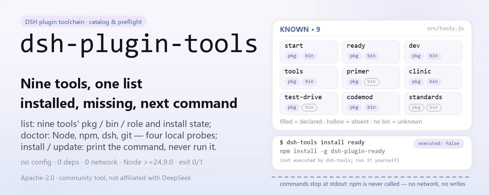
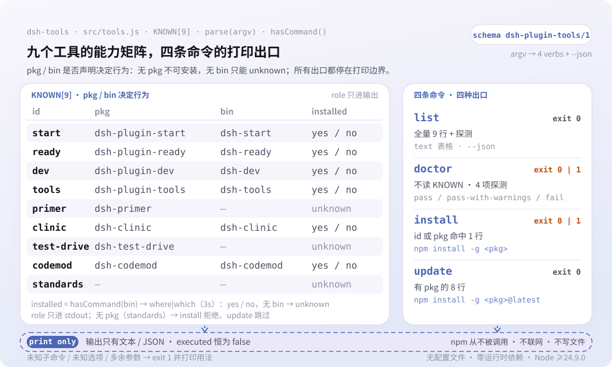

<div align="center">

<picture>
  <source media="(prefers-color-scheme: dark)" srcset="docs/assets/dsh-plugin-tools-hero-en-dark.webp">
  
</picture>

# dsh-plugin-tools

**Toda a cadeia de ferramentas de plugins do DSH em uma só visão: o que está instalado, o que falta no seu ambiente e qual comando executar em seguida.**

`dsh-tools` é um utilitário npx sem dependências: apenas inspeciona e imprime — nunca instala nem atualiza nada, e cada linha `npm install -g` é você quem executa.

[Instalar](#instalação-em-três-passos) · [Configuração](#configuração) · [FAQ](#faq) · [简体中文](README.md) · [English](README.en.md) · [Español](README.es.md) · [Português](README.pt.md) · [हिन्दी](README.hi.md)

[](LICENSE)
[](https://www.npmjs.com/package/dsh-plugin-tools)
[](https://github.com/PerryLink/dsh-plugin-tools/actions/workflows/test.yml)
[](#instalação-em-três-passos)

[](https://github.com/PerryLink/dsh-plugin-tools/stargazers)
[](https://www.npmjs.com/package/dsh-plugin-tools)
[](https://gitee.com/perrylink/dsh-plugin-tools)

```sh
npm i -g dsh-plugin-tools   # instalação global; o comando é dsh-tools
npx dsh-plugin-tools list   # ou execute uma vez sem instalar
```

</div>

<sub>Ferramenta da comunidade, sem afiliação com a DeepSeek. Repositório canônico: <https://github.com/PerryLink/dsh-plugin-tools> (o Gitee é um espelho).</sub>

## O que é

`dsh-plugin-tools` é o catálogo, o verificador prévio e o guia de instalação da cadeia de ferramentas para plugins do DSH. `dsh-tools list` mostra o nome do pacote, o nome do executável e a função de cada uma das nove ferramentas conhecidas, além de indicar se ela já está instalada nesta máquina; `dsh-tools doctor` verifica os quatro pré-requisitos Node, npm, dsh e git; `dsh-tools install <tool>` e `dsh-tools update` imprimem o comando exato `npm install -g` a executar. Ele nunca acessa o registro do npm, nunca grava um arquivo e não audita pacotes, não mexe no host nem produz pontuações ou rankings.

<picture>
  <source media="(prefers-color-scheme: dark)" srcset="docs/assets/dsh-plugin-tools-flow-v5-dark.svg">
  
</picture>

## Instalação em três passos

1. **Instalar** (requer Node ≥24.9.0, conforme `engines.node` do `package.json`):

   ```sh
   # instalação global (recomendada para uso frequente)
   npm i -g dsh-plugin-tools
   # ou execute uma vez sem instalar
   npx dsh-plugin-tools list
   ```

   O comando instalado é `dsh-tools`; `npx dsh-plugin-tools` resolve para o mesmo bin.

2. **Uso rápido**:

   ```sh
   dsh-tools list                        # catálogo completo + status local
   dsh-tools doctor                      # verificação de Node / npm / dsh / git
   dsh-tools install dsh-plugin-ready    # imprime o comando de ready
   dsh-tools update                      # imprime os comandos @latest da família
   ```

3. **Verificar se funciona**:

   ```sh
   dsh-tools --version
   dsh-tools list --json
   ```

   `list --json` emite `schema: dsh-plugin-tools/1`; `doctor` sai com `0` (`pass` ou `pass-with-warnings`) ou `1` (`fail`).

**Desinstalar**: `npm uninstall -g dsh-plugin-tools`.

## Capacidades principais

- **`list`: ver o que existe e o que está instalado.** Imprime o id, o pacote npm, o nome do bin e a função de cada uma das nove ferramentas conhecidas; `installed` assume `yes` / `no` / `unknown`. `primer` e `test-drive` não declaram bin, então são sempre `unknown`.
- **`doctor`: verificação do ambiente antes de instalar.** Verifica Node (limite do código ≥20), npm (se faltar, `fail`), dsh e git (se faltarem, apenas `warn`); o status geral é `pass`, `pass-with-warnings` ou `fail`, com código de saída `1` apenas em `fail`.
- **`install <tool>`: recebe o comando, nada é alterado.** Aceita um id de ferramenta (`ready`) ou um nome de pacote (`dsh-plugin-ready`); a saída em texto sempre inclui `(not executed by dsh-tools; run it yourself)` e o JSON sempre informa `"executed": false`.
- **`update`: gera instruções de atualização em lote.** Imprime `npm install -g <pkg>@latest` para cada ferramenta com pacote e ignora entradas como `standards`, que não têm.
- **`--json`: feito para scripts e CI.** Todos os comandos o aceitam e emitem o `schema: dsh-plugin-tools/1` fixo; `doctor --json` também traz um array `notClaimed` que enumera «não é auditoria de pacotes, não é instalação no host, não é auditoria de segurança».
- **Zero dependências, zero rede.** Em tempo de execução ele importa apenas `node:child_process` e `node:fs`, resolve executáveis com `where` (Windows) ou `which` (Unix); nunca acessa o registro do npm nem grava arquivos.

### Ferramentas conhecidas

| id | pacote npm | executável | função |
|---|---|---|---|
| `start` | `dsh-plugin-start` | `dsh-start` | criar um plugin novo (scaffold) |
| `ready` | `dsh-plugin-ready` | `dsh-ready` | verificação estática prévia |
| `dev` | `dsh-plugin-dev` | `dsh-dev` | despachante unificado |
| `tools` | `dsh-plugin-tools` | `dsh-tools` | gerenciador da cadeia (esta ferramenta) |
| `primer` | `dsh-primer` | — | conhecimento de aprendizado, planejamento e scaffold |
| `clinic` | `dsh-clinic` | `dsh-clinic` | verificações estáticas + de contrato do host |
| `test-drive` | `dsh-test-drive` | — | instalação isolada e teste de fumaça (C3) |
| `codemod` | `dsh-codemod` | `dsh-codemod` | migração de versões |
| `standards` | — | — | especificação ENTRY / FLOW / BOOST e entry-validate |

## Configuração

`dsh-tools` não tem arquivo de configuração, nem variáveis de ambiente, nem profile patch: todo o comportamento vem dos argumentos de linha de comando; sem subcomando, ele executa `list` por padrão.

| opção | aplica-se a | efeito |
|---|---|---|
| `--json` | todos os comandos | emite JSON legível por máquina (`schema: dsh-plugin-tools/1`) |
| `-h`, `--help` | todos os comandos | imprime o uso e sai com `0` |
| `-v`, `--version` | todos os comandos | imprime a versão e sai com `0` |

<details>
<summary>Referência completa de comandos e códigos de saída</summary>

| comando | comportamento | código de saída |
|---|---|---|
| `dsh-tools list [--json]` | imprime o catálogo e o status de instalação local | `0` |
| `dsh-tools doctor [--json]` | imprime o resultado de Node / npm / dsh / git | `0` (pass ou pass-with-warnings); `1` (fail) |
| `dsh-tools install <tool> [--json]` | imprime o comando `npm install -g` dessa ferramenta; nunca o executa | `0`; `1` se a ferramenta for desconhecida ou não instalável |
| `dsh-tools update [--json]` | imprime um comando `@latest` para cada ferramenta instalável; nunca o executa | `0` |
| `dsh-tools --help` / `--version` | imprime o uso ou a versão | `0` |
| comando desconhecido, opção desconhecida, argumento extra | imprime o erro e o uso | `1` |

</details>

<details>
<summary>Exemplos de saída JSON</summary>

`dsh-tools install dsh-plugin-ready --json`:

```json
{
  "schema": "dsh-plugin-tools/1",
  "tool": "ready",
  "package": "dsh-plugin-ready",
  "command": "npm install -g dsh-plugin-ready",
  "executed": false
}
```

`dsh-tools doctor --json`:

```json
{
  "schema": "dsh-plugin-tools/1",
  "tool": "dsh-plugin-tools",
  "version": "0.2.3",
  "generatedAt": "2026-11-06T05:00:00.000Z",
  "status": "pass-with-warnings",
  "checks": [
    { "id": "node", "status": "pass", "detail": "Node 24.9.0; >=20 required" },
    { "id": "npm", "status": "pass", "detail": "npm is required for publishing" },
    { "id": "dsh", "status": "warn", "detail": "dsh CLI is needed for profile/host tests" },
    { "id": "git", "status": "pass", "detail": "git is needed for commits/releases" }
  ],
  "notClaimed": ["not a package audit", "not a host install", "not a security audit"]
}
```

`generatedAt` e cada `detail` variam conforme a máquina; o bloco acima mostra apenas o formato dos campos.

</details>

## FAQ

<details>
<summary>Ele vai instalar ou atualizar algo por mim?</summary>

Não. `install` e `update` apenas imprimem comandos, e o JSON sempre informa `"executed": false`; `test/tools.test.js` verifica que install imprime um comando e não o executa. Copie o comando e execute você mesmo: o que será instalado e onde continua sendo sua decisão.

</details>

<details>
<summary>Preciso de `dsh-plugin-kit` primeiro?</summary>

Não. A lista de ferramentas conhecidas não contém `dsh-plugin-kit`, e os testes afirmam explicitamente que ele nunca aparece; a ferramenta em si não tem dependências de execução.

</details>

<details>
<summary>Ele acessa a internet ou envia dados?</summary>

Não. Nunca acessa o registro do npm, nunca lê um profile e nunca grava um arquivo; `list` apenas consulta o PATH com `where` (Windows) ou `which` (Unix), e `doctor` apenas executa quatro sondagens locais: Node, npm, dsh e git.

</details>

<details>
<summary>Por que `installed` aparece como `unknown` em algumas ferramentas?</summary>

`dsh-primer` e `dsh-test-drive` não declaram o campo bin, então não há nome de executável para sondar e o valor fica `unknown`. As demais são procuradas pelo nome do bin no PATH, por isso uma instalação global fora do PATH é informada como `no`.

</details>

<details>
<summary>Por que o `doctor` diz que o Node é PASS se a instalação exige ≥24.9?</summary>

O `doctor` apenas decide se sua própria lógica de sondagem pode rodar (limite ≥20), enquanto `engines.node: >=24.9.0` no `package.json` é o requisito para instalar esta ferramenta; os dois servem a propósitos diferentes. Veja Limitações conhecidas.

</details>

## Limitações conhecidas

- **Só imprime, nunca executa.** `install` e `update` nunca chamam o npm nem alteram seus pacotes globais; é um limite de projeto, não um recurso pendente.
- **A lista de ferramentas é codificada.** As nove ferramentas ficam na constante `KNOWN` de `src/tools.js`; adicionar ou retirar uma exige uma nova versão para que ela apareça.
- **O estado de instalação depende do PATH.** A detecção roda `where` / `which` sobre o nome do bin, então um pacote global fora do PATH — ou um binário de mesmo nome no PATH — torna `yes` / `no` impreciso; entradas sem bin só podem ser `unknown`.
- **Os limites de Node não coincidem.** O `doctor` dá PASS a partir de ≥20, enquanto `engines.node` no `package.json` exige ≥24.9.0; o primeiro só diz que o `dsh-tools` consegue rodar, o segundo é o requisito de instalação.
- **Não objetivos explícitos.** Sem auditoria de pacotes, sem instalação no host, sem auditoria de segurança, sem pontuação ou ranking; o campo `notClaimed` de `doctor --json` enumera cada uma dessas negativas.
- **`standards` não é instalável.** Não tem pacote npm, então `dsh-tools install standards` falha com código `1`.
- **A análise de argumentos é estrita.** Uma opção desconhecida, um subcomando desconhecido ou um argumento extra geram erro e uso, sem execução parcial.

## Desenvolvimento

```sh
npm install --ignore-scripts --no-audit --no-fund   # sem dependências de execução
npm test                                            # node --test test/*.test.js
node bin/dsh-tools.js list --json                   # executar direto do repositório
```

Sem etapa de build: ESM puro, com `bin/dsh-tools.js` e `src/tools.js` como todo o runtime. A CI é `.github/workflows/test.yml` (matriz Node 20 / 24); a publicação passa por `.github/workflows/release.yml` (disparo manual, `npm publish --provenance`).

| caminho | função |
|---|---|
| `bin/dsh-tools.js` | entrada bin do npm que repassa os argumentos para `src/tools.js` |
| `src/tools.js` | catálogo `KNOWN`, análise de argumentos e list / doctor / install / update |
| `test/tools.test.js` | 3 casos de `node:test` (list / install / doctor) |
| `scripts/gen-readme-assets.py` | gera os quatro hero webp e os SVGs flow-v5 claro/escuro (Python + Pillow) |
| `docs/assets/` | os `dsh-plugin-tools-hero-{zh,en}-{light,dark}.webp` e `dsh-plugin-tools-flow-v5-{light,dark}.svg` gerados |
| `.github/workflows/test.yml` | CI: executa `npm test` no Node 20 e 24 |

As imagens são geradas programaticamente por [`scripts/gen-readme-assets.py`](scripts/gen-readme-assets.py) e podem ser regeneradas a qualquer momento: `python scripts/gen-readme-assets.py`. O script detecta msyh.ttc / msyhbd.ttc / consola.ttf na inicialização e termina com erro se algum faltar; o hero existe nas versões zh e en, enquanto o SVG de estrutura contém apenas tokens de comandos e notas curtas em chinês, e é compartilhado pelos cinco idiomas do README.

## Família e agradecimentos

Este projeto é membro da família de plugins e ferramentas do DeepSeek Harness mantida por [PerryLink](https://github.com/PerryLink) (tudo Apache-2.0). Seus irmãos `dsh-plugin-start`, `dsh-plugin-ready`, `dsh-plugin-dev`, `dsh-clinic`, `dsh-primer`, `dsh-test-drive`, `dsh-codemod` e `dsh-standards` aparecem no catálogo desta ferramenta; para os instaláveis, `dsh-tools install <tool>` entrega o comando.

Se ele economizou uma consulta à documentação, **dê uma estrela** — não desbloqueia nada, mas ajuda a próxima pessoa a encontrá-lo.

## Licença

[LICENSE](LICENSE) (Apache License 2.0) © 2026 dsh-plugin-tools contributors

<p align="center"><sub>Apache-2.0 · Ferramenta da comunidade, sem afiliação com a DeepSeek.</sub></p>
